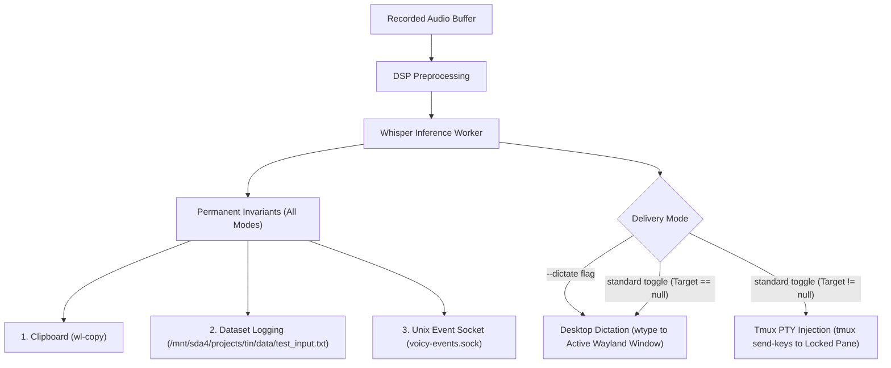
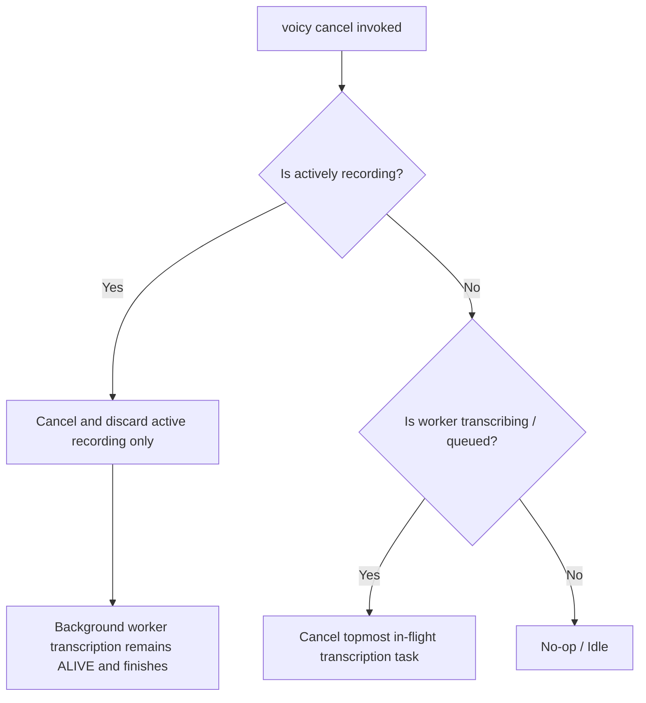

# Voicy Architecture & Delivery Plan: Multi-Channel Routing, Targeting & Cancellation

This document specifies the technical design for Voicy's output routing pipeline, tmux targeting, Unix socket event streaming, defensive data collection, and in-flight cancellation.

---

## 1. High-Level Architecture & Invariants



### Immutable Invariants (Run on EVERY transcription)
1. **Dataset Collection**: Transcriptions are always appended to `/mnt/sda4/projects/tin/data/test_input.txt` and `/mnt/sda4/projects/voicy/input.txt`.
2. **Clipboard Sync**: Transcriptions are always copied to Wayland clipboard via `wl-copy`.
3. **Unix Event Stream**: Transcriptions are always broadcast as JSON events over `voicy-events.sock`.

---

## 2. Delivery Modes: Dictation vs. Targeted Routing

### A. Dictation Mode (`--dictate`)
- Activated by passing the `--dictate` flag:
  ```bash
  voicy toggle --dictate
  voicy start --dictate
  ```
- **Behavior**: Uses simulated keystrokes (`wtype` with `ydotool` fallback) to type directly into whatever Wayland GUI window is currently active and focused (e.g. browser, editor, Discord, terminal).

### B. Standard Targeted Mode (`voicy toggle` without flags)
- **If a target is set (`target != null`)**:
  - Delivers text directly to the locked tmux pane using literal keystrokes:
    ```bash
    tmux send-keys -t "$TARGET" -l -- "$TEXT"
    tmux send-keys -t "$TARGET" Enter
    ```
  - Bypasses Wayland focus entirely: you can speak into a background tmux agent pane while focused on another workspace or window.
- **If no target is set (`target == null`) or target pane is dead**:
  - Automatically falls back to Desktop Dictation (`wtype`), ensuring speech is never lost.

---

## 3. Dynamic Tmux Targeting Controls

### Target State
- Initialized to `None` (`null`) on daemon boot and system reboot.
- Managed in-memory by the daemon with sub-millisecond IPC updates.

### CLI Commands
- `voicy target here`:
  Reads `$TMUX_PANE` from the executing shell environment and locks Voicy onto that exact pane ID (e.g. `%4`).
- `voicy target <pane_or_session>`:
  Locks onto an explicit target (e.g. `agent:0.1`).
- `voicy target clear` / `voicy target null` / `voicy target none`:
  Resets the active target to `None` (returning standard toggle to auto-dictation fallback).
- `voicy target` (no arguments):
  Prints the current target state (e.g., `Active target: %3 (session:main)` or `Active target: null (dictation fallback)`).

---

## 4. LIFO Stack Cancellation Model (`voicy cancel`)

`voicy cancel` (bound to `Super+Shift, D`) operates strictly as a **Last-In, First-Out (LIFO) stack**, canceling only the most recent active layer without disturbing underlying background work:



### Stack Precedence Rules
1. **Layer 1 (Top of Stack: Active Microphone Recording)**:
   - If the user is currently recording:
     - Cancel and discard the active recording buffer.
     - Stop the 30-second timeout safety timer and resume PipeWire playback audio.
     - **Crucial**: Any previous transcription task currently decoding in the background worker thread remains untouched, completes normally, and delivers its output.
2. **Layer 2 (Underlying Stack: In-Flight / Queued Worker Transcription)**:
   - If the user is *not* currently recording, but a transcription task is queued or in-flight:
     - Cancel the topmost transcription task.
     - Suppress output delivery (no typing, no tmux keys).
3. **Layer 3 (Idle)**:
   - If neither recording nor transcribing, returns `idle` with no side effects.

---

## 5. Hyprland Keybind Integration (`~/.config/hypr-minimal/keybinds.conf`)

Current configuration:
- `Super, D` -> `voicy toggle` (Default / Targeted Mode)
- `Super+Shift, D` -> `voicy cancel` (Enhanced In-Flight Cancellation)
- `Alt_R` -> `voicy toggle`
- `F12` / `rF12` -> Push-to-talk `voicy start` / `voicy stop`

Recommended extension:
- Bind a dedicated dictation hotkey (e.g. `Super, V` or `Super+Alt, D`):
  ```ini
  bind = Super+Alt, D, exec, ~/.local/bin/md2tts-stop && ~/.local/bin/voicy toggle --dictate
  ```
